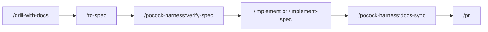

# Agent workflow

This document tells you how to do a task in this repository with Claude Code. It names the skills, the order in which you run them, and the checks that run automatically.

## Install

Install the two plugins once on each machine:

```bash
claude plugin install mattpocock-skills@claude-plugins-official
claude plugin install pocock-harness@protopia-skills
```

The repository already contains the setup. You do not need to run `/setup-matt-pocock-skills` or `/pocock-harness:init` again.

## The flow for a feature

Run each command manually. Each step starts only when you type it.



1. `/grill-with-docs` — Claude asks you questions about the plan until the plan is clear. It writes new terms to `GLOSSARY.md` and new decisions to `docs/adr/`.
2. `/to-spec` — Claude writes a spec from the conversation. It publishes the spec as a GitHub issue with the label `ready-for-agent`. The overlay `docs/agents/spec.md` adds the technical sections.
3. `/pocock-harness:verify-spec <N>` — Claude checks the structure and the content of spec issue `#N` against the code. It writes the result as a footer in the issue.
4. `/implement` or `/implement-spec`:
   - `/implement` does one piece of work in the current session, test-first. Use it for a spec with no tickets.
   - `/implement-spec` does a spec that has tickets. It sends each ticket to an implementer subagent in its own worktree. Then it merges the results on one integration branch.
   - Both skills run `code-review` at the end.
5. `/pocock-harness:docs-sync` — Claude compares the branch diff with the documents in `docs/agents/project-docs.md`. It updates the documents that are out of date and commits them.
6. `/pr` — Claude writes the PR description.

## Shorter flows

| Task | Flow |
|---|---|
| Small change | `/implement` → `/pocock-harness:docs-sync` → `/pr` |
| Large feature (more than one session) | `/wayfinder` → `/to-tickets` → `/implement-spec` → `/pocock-harness:docs-sync` → `/pr` |
| Bug | Describe the bug. Claude uses `diagnosing-bugs`, then `tdd` for the fix. |
| Design question | `/prototype` or `/grill-me` before the spec |
| You do not know which skill to use | `/ask-matt` |

## Skills that Claude starts itself

Claude starts these skills when the task needs them. You can also ask for them by name.

| Skill | Use |
|---|---|
| `tdd` | Write a test first, then the code. |
| `diagnosing-bugs` | Find the cause of a bug or a slow operation. |
| `code-review` | Review the diff against the coding standards and the spec. |
| `domain-modeling` | Change `GLOSSARY.md` or write an ADR. |
| `codebase-design` | Design the interface of a module. |
| `research` | Read primary sources and write the findings to a Markdown file. |
| `pocock-harness:verify-spec` | Check a spec issue. |
| `pocock-harness:docs-sync` | Update the project documents after an implementation. |

## Implementer subagents

The main session gives each code change to an implementer subagent:

| Agent | Code | Standard | Check of the behaviour |
|---|---|---|---|
| `go-developer` | `backend/` | `.claude/rules/go.md` | Tests, test-first |
| `frontend-developer` | `frontend/` | `.claude/rules/frontend.md` | The `browser-check` skill and `make frontend-screenshots` |

The two agents have different work loops and different limits. `go-developer` writes a test first. `frontend-developer` checks each change in the browser and does not change Go code. The `SubagentStop` hook of the quality gate selects the agents by name.

### Rules and skills

A rule holds a coding standard. A skill holds a procedure.

- A rule in `.claude/rules/` has a `paths:` list. Claude Code loads the rule automatically when Claude reads or edits a matching file. This also applies to the main session and to a review.
- Claude does not load a rule when it reads a diff only, for example the output of `git diff`. Before such a review, read the rule.
- The skill `browser-check` tells how to check a page in the browser. `frontend-developer` preloads it.

## Quality gate

The script `.claude/hooks/quality-gate.sh` runs the build and the tests. It runs at two points:

1. When `go-developer` or `frontend-developer` stops (hook `SubagentStop`).
2. Before each `git push` that Claude runs (hook `PreToolUse`). The wrapper `.claude/hooks/gate-on-push.sh` checks that the command really runs `git push`, and then calls the gate. The `if` filter in `settings.json` is only a cheap pre-filter.

The gate reads its commands from `env` in `.claude/settings.json`:

- `QG_BUILD_CMD`: `make gate-build`
- `QG_TEST_CMD`: `make gate-test`

Both targets call `scripts/gate.sh`. The script compares the tree with the merge base of `origin/main` and selects the stacks:

| Changed path | Build | Tests |
|---|---|---|
| `backend/` | `go -C backend build ./...` | `make test && make lint` |
| `frontend/` | `make frontend-check` | none |
| Another path, for example `Makefile` or `.claude/` | both | `make test && make lint` |
| Only `docs/` or `*.md` | none | none |

The gate does not run the screenshot tests (`make frontend-screenshots`), because they are slow and need Chromium. `frontend-developer` runs them before it reports. CI does not run them.

To see the selected stacks, run `scripts/gate.sh stacks`.

### Worktrees

`/implement-spec` runs each implementer subagent in its own worktree. Two settings make the gate work there:

- The `SubagentStop` hook sets `CLAUDE_PROJECT_DIR="$PWD"`. Claude Code keeps `CLAUDE_PROJECT_DIR` at the main checkout, but the hook process starts in the worktree. Without the override, the gate tests the main checkout.
- `worktree.symlinkDirectories` links `frontend/node_modules` to the main checkout. When the two `package-lock.json` files are the same, the gate uses the link and does not run `npm ci`. When they are different, the gate removes the link and runs `npm ci` in the worktree.

If you run `/pocock-harness:init` again, it replaces the `SubagentStop` command. Add the override again after the run.

The gate runs the tests through `.claude/hooks/with-test-lock.sh`. The lock lets only one test run on the machine at a time.

The gate skips the run in these cases:

- No file outside `docs/` and `*.md` changed.
- The code is the same as at the last green run. The gate keeps this state in `.git/pocock-harness/`.

A red gate stops the subagent or blocks the push. Claude gets the last 60 lines of the output.

The gate does not run at the end of a normal chat turn. The repository has no `Stop` hook on purpose, because a full run takes more than 2 minutes. If you run `/pocock-harness:init` again, it adds the `Stop` hook again. Remove the hook after the run.

The gate does not check a push from your own terminal. CI (`.github/workflows/ci.yml`) checks each push.

To stop the gate on one machine, set `QG_GATE_DISABLE=1`.

## Checks before a commit

`AGENTS.md` adds these steps to the flow:

1. Run the second review with Codex before each commit of code. See `AGENTS.md`, section "Second review with Codex".
2. After a frontend change, check the changed pages in the browser.

## Files of the setup

| File | Purpose |
|---|---|
| `AGENTS.md`, section `## Agent skills` | The instructions that the skills read |
| `docs/agents/issue-tracker.md` | The issue tracker: GitHub Issues |
| `docs/agents/triage-labels.md` | The triage labels |
| `docs/agents/domain.md` | Where the glossary and the ADRs are |
| `docs/agents/spec.md` | The extra spec sections for this repository |
| `docs/agents/project-docs.md` | The documents that `docs-sync` updates |
| `docs/repo-map.md` | Where each part of the code is |
| `.claude/hooks/quality-gate.sh`, `.claude/hooks/with-test-lock.sh` | The quality gate and the test lock |
| `.claude/settings.json` | The hooks and the gate commands |
